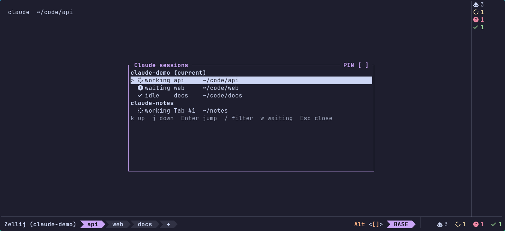
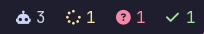
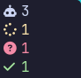

# zellij-claude sessions

[](https://github.com/ferenyl/zellij-claude/actions/workflows/ci.yml)

A [Zellij](https://zellij.dev) plugin that tracks every running [Claude Code](https://code.claude.com) session and shows whether it is working, waiting for you, or idle.

- **Picker**: a floating window listing all Claude sessions, across tabs and Zellij sessions. Press `Enter` to jump straight to the pane.
- **Status bar**: a compact panel with the number of sessions and a count per state, horizontal or vertical.

Status comes from Claude Code hooks, so it is exact: the plugin knows the moment Claude starts working, asks for permission, or finishes.



| Horizontal bar | Vertical bar |
|----------------|--------------|
|  |  |

## Contents

- [Requirements](#requirements)
- [Quick start](#quick-start)
- [Installation](#installation)
- [Configuration](#configuration)
- [Keybindings](#keybindings)
- [Layouts](#layouts)
- [How status works](#how-status-works)
- [Troubleshooting](#troubleshooting)
- [Architecture](#architecture)
- [Compatibility](#compatibility)
- [Updating and uninstalling](#updating-and-uninstalling)
- [Development and tests](#development-and-tests)
- [Contributing](#contributing)

## Requirements

- Zellij **0.45.1** (see [Compatibility](#compatibility))
- Claude Code with hooks support
- `jq` (used by the hook script)
- A [Nerd Font](https://www.nerdfonts.com) for the default icons. Without one, set `icons "unicode"`.
- To build from source: Rust (version pinned in `rust-toolchain.toml`) with the `wasm32-wasip1` target

## Quick start

```sh
# 1. Install the plugin and hook script from the latest release
mkdir -p ~/.config/zellij/plugins
cd ~/.config/zellij/plugins
curl -fsSLO https://github.com/ferenyl/zellij-claude/releases/latest/download/claude-sessions.wasm
curl -fsSLO https://github.com/ferenyl/zellij-claude/releases/latest/download/claude-zellij-hook.sh
chmod +x claude-zellij-hook.sh
```

2. Add the hooks from [`examples/claude-settings.json`](examples/claude-settings.json) to `~/.claude/settings.json`.
3. Add the keybinding from [`examples/config.kdl`](examples/config.kdl) to `~/.config/zellij/config.kdl`.
4. Start `claude` in a Zellij pane and press `Alt c`. Approve the permission prompt the first time.

## Installation

### From a GitHub Release

Each [release](https://github.com/ferenyl/zellij-claude/releases) has these assets:

| Asset | Contents |
|-------|----------|
| `claude-sessions.wasm` | The plugin |
| `claude-zellij-hook.sh` | The Claude Code hook script |
| `claude-sessions-<version>.tar.gz` | Both of the above, plus `examples/`, `README.md` with its screenshots and `LICENSE` |
| `SHA256SUMS` | Checksums of all assets |

Verify the download:

```sh
curl -fsSLO https://github.com/ferenyl/zellij-claude/releases/latest/download/SHA256SUMS
sha256sum --check --ignore-missing SHA256SUMS
```

Releases also carry a [build provenance attestation](https://docs.github.com/actions/security-for-github-actions/using-artifact-attestations): `gh attestation verify claude-sessions.wasm --repo ferenyl/zellij-claude`.

Zellij can also load the plugin directly from a URL, without downloading it:

```kdl
plugin location="https://github.com/ferenyl/zellij-claude/releases/download/v0.1.0/claude-sessions.wasm"
```

Pin a version in the URL; `latest` would change under you. The hook script still has to be installed locally.

### From source

```sh
git clone https://github.com/ferenyl/zellij-claude
cd zellij-claude
./scripts/install.sh
```

`install.sh` builds the plugin and copies it and the hook script to `~/.config/zellij/plugins/` (override with `ZELLIJ_PLUGIN_DIR`). It does not touch your Claude or Zellij configuration.

### Claude Code hooks

Merge [`examples/claude-settings.json`](examples/claude-settings.json) into `~/.claude/settings.json`. It registers the hook script for these events:

`SessionStart`, `UserPromptSubmit`, `PreToolUse`, `PostToolUse`, `PermissionRequest`, `Notification` (only `permission_prompt`), `Stop`, `SessionEnd`.

If you already have hooks for an event, add ours as another entry in the same `hooks` list; Claude runs all matching hooks in parallel:

```json
"SessionStart": [
  {
    "matcher": "^(startup|resume|clear|compact|fork)$",
    "hooks": [
      { "type": "command", "command": "bash ~/.claude/hooks/my-existing-hook.sh" },
      { "type": "command", "command": "~/.config/zellij/plugins/claude-zellij-hook.sh" }
    ]
  }
]
```

Or add a separate group without a `matcher` so our hook runs for every occurrence:

```json
"SessionStart": [
  { "matcher": "...", "hooks": [ ...existing... ] },
  { "hooks": [{ "type": "command", "command": "~/.config/zellij/plugins/claude-zellij-hook.sh" }] }
]
```

The hook does nothing outside Zellij and always exits 0, so it never interferes with Claude.

## Configuration

Settings go in the plugin's config block, in a layout or a keybinding:

```kdl
plugin location="file:~/.config/zellij/plugins/claude-sessions.wasm" {
    mode "bar"
    icons "unicode"
    align "right"
}
```

All values are strings, as Zellij passes them. Booleans accept `true`/`false` (also `yes`/`no`, `on`/`off`, `1`/`0`). Unknown keys and invalid values are shown as a warning in the plugin pane; invalid values fall back to their default.

<!-- config-table:start -->
| Key | Default | Description |
|-----|---------|-------------|
| `mode` | `picker` | `picker` or `bar` |
| `icons` | `nerd` | Icon set: `nerd` or `unicode` |
| `icon_working` | from icon set | Icon for `working` |
| `icon_waiting` | from icon set | Icon for `waiting` |
| `icon_idle` | from icon set | Icon for `idle` |
| `icon_session` | from icon set | Icon before the total count in the bar |
| `color_working` | terminal yellow | Bar color for `working`: `#rrggbb`, `0`–`255`, or a name like `red`, `bright_blue` |
| `color_waiting` | terminal red | Bar color for `waiting` |
| `color_idle` | terminal green | Bar color for `idle` |
| `all_sessions` | `true` (picker), `false` (bar) | Include Claude sessions from other Zellij sessions |
| `orientation` | `auto` | Bar layout: `auto`, `horizontal` or `vertical`. `auto` is vertical when the pane is taller than wide or the row does not fit |
| `align` | `left` | Bar alignment: `left` or `right` |
| `vertical_align` | `top` | Bar placement: `top` or `bottom` |
| `show_zero` | `true` | Show states with a zero count in the bar |
| `blink_waiting` | `false` | Blink the waiting icon in the bar while a session is waiting |
| `status_dir` | `$XDG_CACHE_HOME/claude-zellij` | Status file directory; must match the hook's directory. `~` is expanded |
| `poll_interval_secs` | `2` | How often status files are re-read |
| `stale_after_secs` | `3600` | Drop entries of Zellij sessions that are gone after this many seconds |
| `key_up` | `k,Up` | Picker: move up |
| `key_down` | `j,Down` | Picker: move down |
| `key_select` | `Enter` | Picker: jump to the selected session |
| `key_close` | `Esc,q` | Picker: close |
| `key_filter` | `/` | Picker: start type-to-filter |
| `key_jump_waiting` | `w` | Picker: jump to the first waiting session |
| `show_state_text` | `true` | Picker: show the state name in each row |
| `show_cwd` | `true` | Picker: show the working directory (else the pane title) |
| `fallback_detect` | `false` | Also list panes without hooks whose title or command mentions Claude (shown as idle) |
| `bind_open_key` | none | Opt-in: bind this key to open the picker at load time, e.g. `Alt c` |
| `plugin_location` | `file:~/.config/zellij/plugins/claude-sessions.wasm` | Plugin URL used by `bind_open_key` |
<!-- config-table:end -->

Default icons:

| State | `nerd` | `unicode` |
|-------|--------|-----------|
| total | 󰚩 | ◆ |
| working |  | ● |
| waiting |  | ▲ |
| idle |  | ✔ |

## Keybindings

### Opening the picker

The key that opens the picker lives in your Zellij `config.kdl`. Pick any free key:

```kdl
keybinds {
    shared_among "normal" "locked" {
        bind "Alt c" {
            LaunchOrFocusPlugin "file:~/.config/zellij/plugins/claude-sessions.wasm" {
                floating true
                move_to_focused_tab true
                mode "picker"
            }
        }
    }
}
```

`shared_among "normal" "locked"` makes it work in both modes, including with `default_mode "locked"`. With `shared_except "locked"` it would not work while locked.

The picker is its own plugin instance. It never toggles or hides your regular floating panes, and it hides itself after a jump.

**Alternative:** set `bind_open_key "Alt c"` on a plugin instance that is loaded from your layout (for example the bar). It registers the binding with Zellij's `reconfigure` when the plugin loads, without editing `config.kdl`, and asks for the extra `Reconfigure` permission. It applies to the client the plugin is attached to, so it does not work for instances started with `zellij action launch-plugin`.

### Inside the picker

| Default key | Action |
|-------------|--------|
| `k`, `Up` | Move up |
| `j`, `Down` | Move down |
| `Enter` | Jump to the session's tab and pane, switching Zellij session if needed |
| `/` | Filter by session, tab, title or path. `Backspace` edits, `Esc` clears |
| `w` | Jump to the first waiting session |
| `Esc`, `q` | Close |

Change them with the `key_*` settings, as comma-separated lists. Key names follow Zellij: `a`, `Up`, `Enter`, `Esc`, `Tab`, `PageUp`, `F5`, `Ctrl n`, `Alt j`.

## Layouts

**Horizontal bar** above the tab bar ([`examples/layout-horizontal.kdl`](examples/layout-horizontal.kdl)):

```kdl
layout {
    default_tab_template {
        children
        pane size=1 borderless=true {
            plugin location="file:~/.config/zellij/plugins/claude-sessions.wasm" {
                mode "bar"
                align "right"
            }
        }
        pane size=1 borderless=true {
            plugin location="zellij:tab-bar"
        }
    }
}
```

**Bar next to the tab bar**, sharing its row:

```kdl
pane size=1 split_direction="vertical" {
    pane borderless=true {
        plugin location="tab-bar"
    }
    pane size=20 borderless=true {
        plugin location="file:~/.config/zellij/plugins/claude-sessions.wasm" {
            mode "bar"
            align "right"
        }
    }
}
```

A pane that contains other panes cannot be `borderless`; put `borderless=true` on the inner panes. If you use swap layouts, make the same change in their `tab_template`.

**Vertical bar** in a side column ([`examples/layout-vertical.kdl`](examples/layout-vertical.kdl)): a narrow pane with `orientation "vertical"`.

**Picker only**: no layout change needed, just the keybinding.

Panes in `default_tab_template` appear in every new tab; panes in a single `tab` do not.

The first time a bar loads, Zellij asks for permissions inside the bar pane. In a one-row pane, focus it (click it) and press `y`. After that the bar is not selectable, so focus never lands on it.

## How status works

```
Claude Code hook ──► claude-zellij-hook.sh ──┬──► status file (all Zellij sessions)
                                             └──► zellij pipe (current session, instant)
                                                              │
Zellij SessionUpdate (tabs, panes, sessions) ────────────────►│──► plugin ──► picker / bar
```

| Hook event | State |
|------------|-------|
| `SessionStart`, `Stop` | idle |
| `UserPromptSubmit`, `PreToolUse`, `PostToolUse`, `PostToolUseFailure` | working |
| `Notification` (permission prompt), `PermissionRequest` | waiting |
| `SessionEnd` | removed |

The hook writes one JSON file per pane to `$CLAUDE_ZELLIJ_STATUS_DIR`, else `$XDG_CACHE_HOME/claude-zellij`, else `~/.cache/claude-zellij`:

```json
{"zellij_session":"work","pane_id":12,"hook_event":"Notification","cwd":"/home/user/project","claude_session_id":"abc123","updated_at":1760558400}
```

The file is written atomically, then sent over `zellij pipe` so the current session updates at once. Plugin instances in every Zellij session re-read the directory every `poll_interval_secs`, which is how sessions in other Zellij sessions show up. The newest update wins.

Entries are removed when:

- Claude ends (`SessionEnd` deletes the file),
- the pane is closed or Claude is killed (the pane is gone from Zellij; there is a 10 s grace period for new panes),
- the Zellij session has been gone for `stale_after_secs`.

The plugin deletes the status files of removed entries.

### Permissions

| Permission | Why |
|------------|-----|
| `ReadApplicationState` | Tabs, panes and sessions |
| `ChangeApplicationState` | Focus panes, switch sessions, hide the picker |
| `ReadCliPipes` | Receive `zellij pipe` messages from the hook |
| `FullHdAccess` | Read and clean up the status directory |
| `ReadSessionEnvironmentVariables` | Find `HOME` / `XDG_CACHE_HOME` for the default status directory |
| `Reconfigure` | Only with `bind_open_key` |

## Troubleshooting

**Icons show as boxes or question marks.** Your terminal font is not a Nerd Font. Install one, or set `icons "unicode"`.

**Status does not update.**
- Check that the hooks are in `~/.claude/settings.json` and that `jq` is installed.
- Run `echo "$ZELLIJ_SESSION_NAME $ZELLIJ_PANE_ID"` in the pane: both must be set (Claude must run inside Zellij).
- Look for files in `~/.cache/claude-zellij/`. If you set `status_dir`, set `CLAUDE_ZELLIJ_STATUS_DIR` to the same path for the hook.

**"waiting for status dir" in the plugin.** The directory is created by the hook on its first run. The plugin retries automatically.

**Permission prompt does not show / plugin is empty.** Focus the plugin pane and answer the prompt. To reset answers, edit `~/.cache/zellij/permissions.kdl`.

**An entry stays after Claude exited.** Entries of live Zellij sessions disappear when the pane closes. Entries of Zellij sessions that are gone expire after `stale_after_secs`. A pane that keeps running a shell after Claude was killed with `kill -9` stays until the pane closes or Claude starts again there.

**Another Zellij session shows `?` as tab name.** The plugin asks Zellij for the session list every `poll_interval_secs`; a just-created session fills in on the next poll. If it stays `?`, check that the session is running (`zellij ls`).

**Jumping to another Zellij session does nothing.** The target session must be running (`zellij ls`). Exited sessions are not resurrected by the picker.

**`Alt c` does nothing in locked mode.** Bind it under `shared_among "normal" "locked"`, see [Keybindings](#keybindings).

**`bind_open_key` has no effect.** Set it on an instance loaded from a layout or keybinding, not one started with `zellij action launch-plugin`.

## Architecture

A Cargo workspace with two crates:

- `crates/core`: all logic in plain Rust, built and tested on the native target: config parsing, hook event mapping, status files, the session store (merging, pruning, fallback detection), picker model and rendering, bar rendering, key parsing, colors and width-aware truncation.
- `crates/plugin`: a thin `ZellijPlugin` shell compiled to `wasm32-wasip1`. It converts Zellij events into core calls and core output into terminal output and Zellij API calls.

`scripts/claude-zellij-hook.sh` is the Claude Code hook (POSIX sh + `jq`).

## Compatibility

| Component | Tested version |
|-----------|----------------|
| Zellij | 0.45.1 |
| `zellij-tile` | 0.45.1 |
| Rust | see `rust-toolchain.toml` |

The plugin is built against the `zellij-tile` version matching the supported Zellij release. Other Zellij versions may fail to load it.

## Updating and uninstalling

**Update:** replace `claude-sessions.wasm` and `claude-zellij-hook.sh` in `~/.config/zellij/plugins/` (download a newer release, or run `./scripts/install.sh` again). Permissions are remembered per plugin path, so keeping the path avoids new prompts. Running plugins keep the old version until reloaded: start a new Zellij session, or run `zellij action start-or-reload-plugin "file:$HOME/.config/zellij/plugins/claude-sessions.wasm"`.

**Uninstall:**

1. Remove the hook entries from `~/.claude/settings.json`.
2. Remove the keybinding and any `claude-sessions.wasm` panes from your Zellij config and layouts.
3. Delete the files:

   ```sh
   rm ~/.config/zellij/plugins/claude-sessions.wasm ~/.config/zellij/plugins/claude-zellij-hook.sh
   rm -r ~/.cache/claude-zellij
   ```

4. Optionally remove the plugin's entry from `~/.cache/zellij/permissions.kdl`.

## Development and tests

Requirements: Rust from `rust-toolchain.toml` with the `wasm32-wasip1` target, and `jq`. The Zellij tests also need Zellij 0.45.1 and `script` (util-linux).

```sh
# Build the plugin
cargo build --release --target wasm32-wasip1 -p claude-sessions-plugin

# Unit, snapshot, examples and README tests (what CI runs, with fmt, clippy and the wasm build)
cargo test --workspace

# Hook script tests: hermetic, with a stub `zellij`
sh tests/hook/test_hook.sh

# End-to-end test: starts a real Zellij with the built plugin
sh tests/e2e/run.sh
```

The end-to-end test runs in isolation: its own `HOME`, cache, socket directory and session name, so it does not touch your Zellij sessions, permissions or status files. It attaches a client through a pseudo-terminal (`script`), loads the plugin from a layout with pre-granted permissions, and passes when the plugin deletes the status file of a long-gone session and keeps the live one. Pass a path to test another build: `sh tests/e2e/run.sh path/to/claude-sessions.wasm`. The hook and end-to-end tests are not run in CI.

To try a local build in your running Zellij:

```sh
zellij action start-or-reload-plugin "file:$PWD/target/wasm32-wasip1/release/claude-sessions.wasm"
```

## Contributing

See [CONTRIBUTING.md](CONTRIBUTING.md) for code style and dependency updates, and [RELEASING.md](RELEASING.md) for the release process.

## License

[GPL-3.0](LICENSE)
